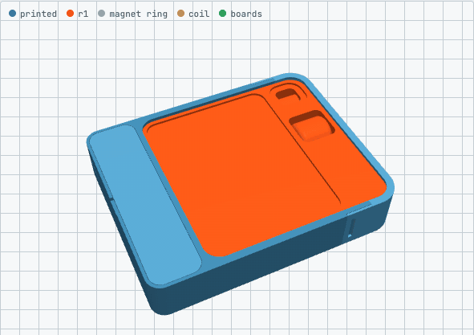

# Bunnycage

A two-part 3D-printed case that snaps the Rabbit r1 onto any MagSafe mount and charges it wirelessly (Qi, 5 V / 1 A). A USB-C socket on the edge passes cable power and USB 2.0 data through (USB-A-to-C cables only). Rev A, not yet printed or fitted to a real r1.

- **Build guide:** https://claude.ai/artifact/U1EJkFL8vgDhy9p68WVTH6 (source in `guide/`)
- **Print these:** `stl/bunnycage_fit_test.stl` and `stl/bunnycage_port_test.stl` first, then `stl/bunnycage_body.stl` and `stl/bunnycage_lid.stl`
- **Parts:** see `BOM.md`
- **Change the design:** edit the parameters at the top of `cad/bunnycage.scad`, then run `cad/build.sh` (needs OpenSCAD)
